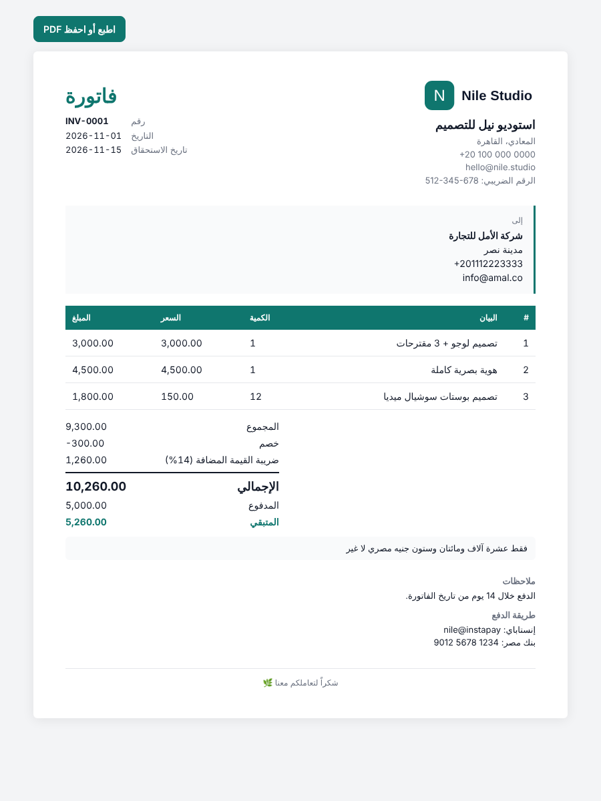
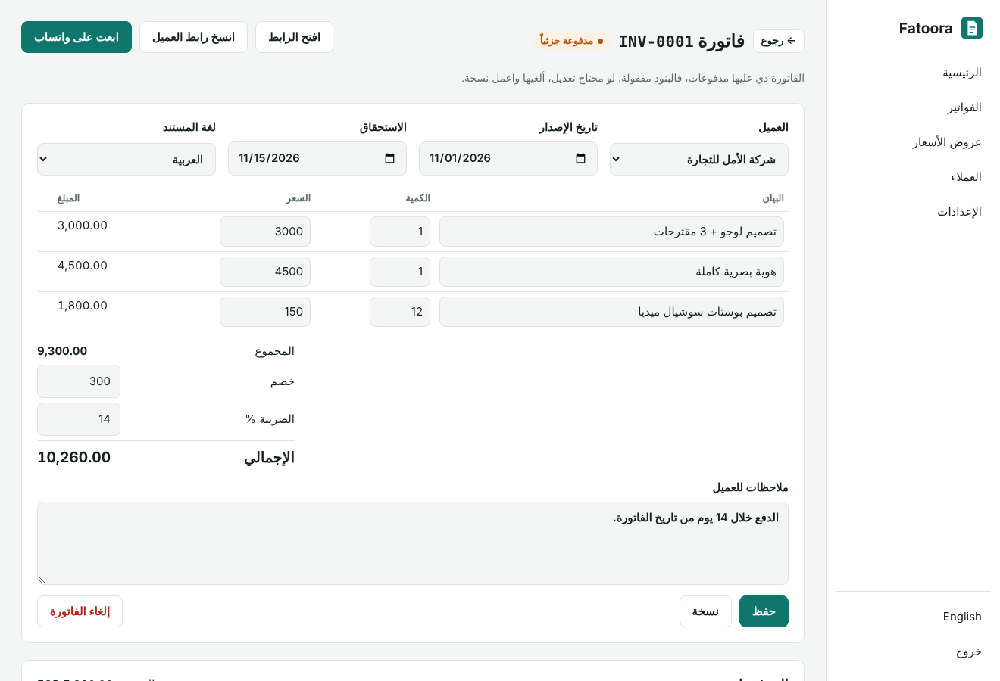
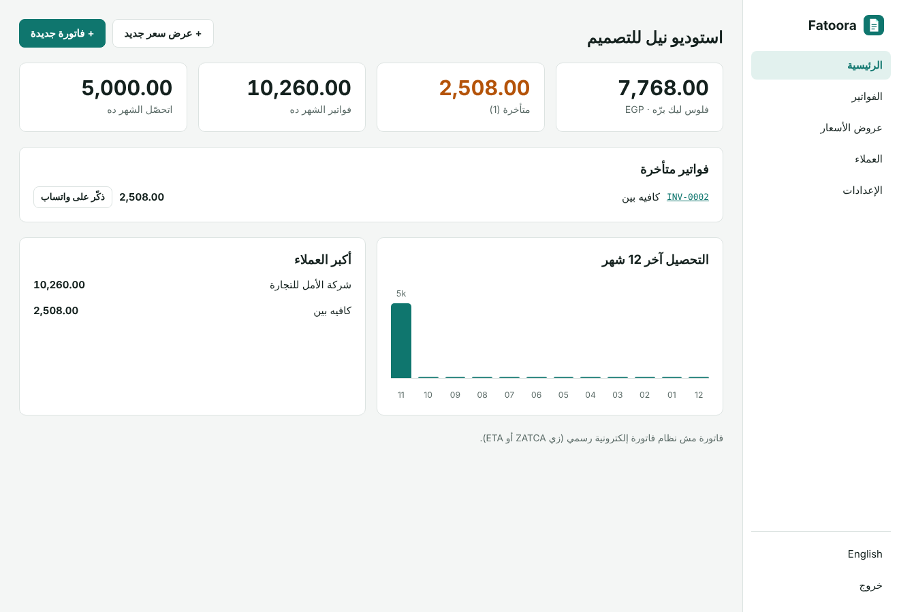

<div align="center">

# Fatoora · فاتورة

**Professional invoices and quotes, in Arabic and English.**
For freelancers, agencies and small businesses. Send a link, get paid, follow up on WhatsApp. Open source, self-hosted, no monthly fees.

[](https://www.hostinger.com/docker-hosting?compose_url=https://raw.githubusercontent.com/mashraf1997/fatoora/main/docker-compose.yml&REFERRALCODE=YOUR_REFERRAL_CODE)

[English](#what-it-does) · [العربية](#بالعربي)



</div>

---

## What it does

- **Invoices and quotes that look professional**, in Arabic (right to left) or English, with your logo, color and payment details.
- **Amount in words**, as Arab clients expect it: «فقط عشرة آلاف ومائتان وستون جنيه مصري لا غير». English too.
- **A link for your client.** They open it on any phone, print it or save it as a PDF. Quotes have an **Accept** button, and accepted quotes become invoices with one click.
- **Send and follow up on WhatsApp.** One click opens WhatsApp with a ready message and the link. Overdue invoices get a polite reminder message.
- **Payments.** Record full or partial payments, see the balance, and the invoice is marked **paid** automatically. Lines lock once money is received, to keep your records honest.
- **Know where your money is.** Amount owed to you, overdue amount, invoiced and collected this month, collections over the last 12 months, and top clients.
- **Taxes and discounts**, automatic numbering (`INV-0001`, `Q-0001`), payment terms, CSV export for your accountant.

> Fatoora makes invoices for your clients. It is **not** an official e-invoicing system (such as ZATCA in Saudi Arabia or ETA in Egypt). Check whether your business is required to use one.

<p align="center">
  
  
</p>

## Deploy

**One click:** press **Deploy on Hostinger** above, open `http://YOUR-SERVER-IP` and create your password. A domain with HTTPS makes the client links look trustworthy.

**Docker:**

```bash
git clone https://github.com/mashraf1997/fatoora.git && cd fatoora
docker compose up -d
```

**Node.js 20+:** `npm start`. No dependencies.

| Variable | Default | Purpose |
|---|---|---|
| `PORT` | `3000` | HTTP port |
| `DATA_DIR` | `./data` | Where `fatoora.json` is stored. Back it up. |
| `SETUP_TOKEN` | *(empty)* | Required to create the first admin when set |
| `DEMO_MODE` | `false` | `true` makes this a public demo: sample data, a reset every hour, and settings that reach outside (tokens, keys, password) locked |
| `DEMO_PASSWORD` | `demo1234` | Password shown on the demo sign-in screen |
| `DEMO_RESET_MINUTES` | `60` | How often the demo data resets (minimum 5) |
| `DEMO_LANG` | `ar` | Language of the sample data: `ar` or `en` |

## Development

```bash
npm test
```

## More open-source tools for small businesses

[Wakeel](https://github.com/mashraf1997/wakeel) (AI customer service) · [Dukkan](https://github.com/mashraf1997/dukkan) (WhatsApp store) · [Mawid](https://github.com/mashraf1997/mawid) (bookings) · [Nashr](https://github.com/mashraf1997/nashr) (social media) · [Khatm](https://github.com/mashraf1997/khatm) (loyalty cards) · [Moallem](https://github.com/mashraf1997/moallem) (tutors)

## License

MIT

---

<div dir="rtl">

## بالعربي

**فاتورة** نظام مفتوح المصدر لعمل فواتير وعروض أسعار احترافية بالعربي والإنجليزي، للفريلانسرز والوكالات والمشاريع الصغيرة.

- **فواتير وعروض أسعار بشكل احترافي** باللوجو واللون وبيانات الدفع بتاعتك.
- **المبلغ بالحروف:** «فقط عشرة آلاف ومائتان وستون جنيه مصري لا غير».
- **رابط للعميل** يفتحه من موبايله ويطبعه أو يحفظه PDF. وعرض السعر فيه زرار **موافق**، وتحوّله لفاتورة بضغطة.
- **إرسال ومتابعة على واتساب** برسالة جاهزة، وتذكير مهذب للفواتير المتأخرة.
- **المدفوعات:** دفع كامل أو جزء، والفاتورة بتتعلم **مدفوعة** لوحدها.
- **تعرف فلوسك فين:** اللي ليك برّه، والمتأخر، واللي اتحصّل الشهر ده، وأكبر العملاء.

> فاتورة **مش** نظام الفاتورة الإلكترونية الرسمي (زي ZATCA في السعودية أو منظومة الضرائب في مصر). اتأكد لو نشاطك ملزم بيه.

</div>
